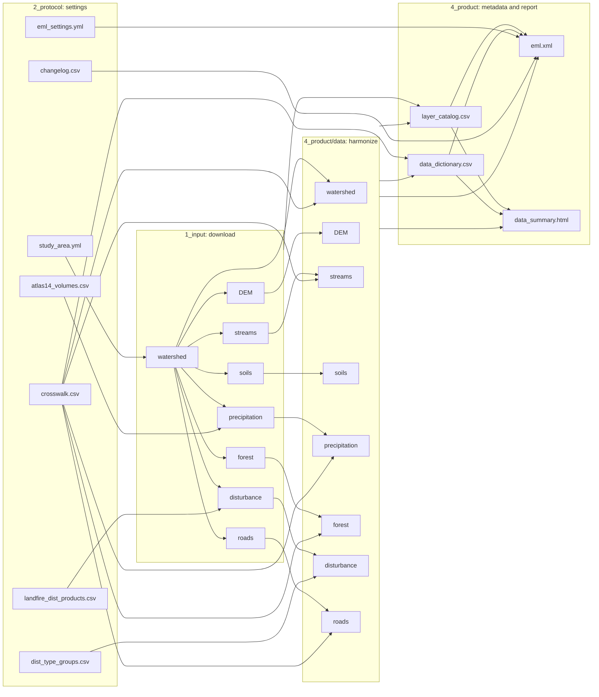

# Reproducible aggregation of public geospatial data for steep-terrain watersheds

An R pipeline that builds a harmonized, documented geospatial dataset for any watershed in the lower 48 states from public sources: terrain, streams, soil erodibility, rainfall intensity, forest structure, disturbance history, and forest roads. One command downloads every layer, puts them on a common grid with consistent attributes and units, documents every step, runs quality checks, and produces a summary report and standards-based (EML) metadata.

The pilot watershed is **Upper Tenderfoot Creek, Montana (HUC12 100301030801)**, which contains the Tenderfoot Creek Experimental Forest. The project is an LRES 511 (Environmental Data Management) term project supporting thesis research on erosion and sediment delivery in steep, disturbed Rocky Mountain watersheds.

Author: Joel Wise, Montana State University

## Quick start

**Requirements:** R 4.6.1 and RStudio. Quarto comes with RStudio. Git is optional for running the pipeline, but with git installed the layer catalog and EML record the exact code version used. On Windows, installing [Rtools](https://cran.r-project.org/bin/windows/Rtools/) lets `renv` install exact package versions even after an R update (see the processing guide).

1. Download or clone this repository.
2. Open `project.Rproj` in RStudio. Always open the project this way, so R starts in the right folder.
3. Open `run.R` and set the watershed's 12-digit HUC12 code on the `huc12 <-` line (keep the quotes).
4. Click **Source** (top right of the editor).

`run.R` writes the HUC12 into `2_protocol/config/study_area.yml`, installs the exact package versions recorded in `renv.lock`, builds everything with `targets`, and opens the report. A first run takes several minutes, most of it downloading 27 years of LANDFIRE disturbance data. Later runs skip anything that hasn't changed.

To find a watershed's HUC12 code from a point on a map:

```r
source("2_protocol/R/utils.R")
source("2_protocol/R/get_watershed.R")
find_huc12(lon = -110.93, lat = 46.93)   # longitude first; negative in the US
```

To test the pipeline on a random watershed, set `huc12 <- "random"` in `run.R`. Random tests are recorded in `2_protocol/testing_log.csv`.

## What it produces

All in `4_product/`:

| File | Contents |
| --- | --- |
| `data/` | Harmonized layers (listed below), all in EPSG:5070 on a 10 m grid, plus two lookup tables: soil map unit values and `disturbance_codes_<HUC12>.csv`, which lists LANDFIRE's own disturbance type and severity labels with the group and class assigned to each |
| `data_summary.html` | Report with maps, automated quality checks, the layer catalog, and the data dictionary |
| `data_dictionary.csv` | Every variable: definition, units, data type, range, missing values, processing |
| `layer_catalog.csv` | Every layer: source, version, retrieval date, raw-file checksum, native and output coordinate systems, processing, and the scripts and code version that made it |
| `eml.xml` | Ecological Metadata Language 2.2 metadata, validated against the schema, with file checksums, code lists, and the dataset's revision history |

Harmonized layers:

| Layer | Variables | Format |
| --- | --- | --- |
| Watershed boundary | name, HUC12, area, downstream HUC12 | GeoPackage |
| Streams | name, length, stream order, drainage area, elevation, slope, routing IDs | GeoPackage |
| Elevation | `elevation_m` | Cloud-optimized GeoTIFF |
| Soils | `soil_kw` (whole-soil K), `soil_kf` (fine-earth K), `soil_pct_no_k` (percent rock, rubble, or water) | Cloud-optimized GeoTIFF |
| Rainfall intensity | `precip_2yr_30m`, `precip_2yr_60m`, `precip_2yr_06h` (mm/hr) | Cloud-optimized GeoTIFF |
| Forest structure | `forest_cc` (canopy cover, %), `forest_ch` (canopy height, m) | Cloud-optimized GeoTIFF |
| Disturbance history | `dist_last_harvest_year`, `dist_last_fire_year`, `dist_last_insect_year`, `dist_count`, `dist_last_severity` | Cloud-optimized GeoTIFF |
| Roads | road number, name, length, jurisdiction, route status, maintenance levels, functional class, surface type, open for use to | GeoPackage |

The outputs included in this repository are for the pilot watershed. Running another watershed replaces them on your computer.

## Data sources

| Layer | Source | Access |
| --- | --- | --- |
| Watershed boundary | USGS Watershed Boundary Dataset | `nhdplusTools` |
| Elevation | USGS 3DEP 1/3 arc-second (~10 m) seamless DEM | Direct read of 3DEP tiles |
| Streams | USGS NHDPlus High Resolution network flowlines | `nhdplusTools` web service query |
| Soils | NRCS SSURGO (K-factors) | `soilDB` Soil Data Access |
| Rainfall intensity | NOAA Atlas 14, 2-year storm (30 min, 1 hr, 6 hr); volume chosen automatically by location | NOAA grid downloads |
| Forest structure | LANDFIRE 2024 canopy cover and canopy height | `rlandfire` (LANDFIRE Product Service) |
| Disturbance history | LANDFIRE Annual Disturbance, 1999 to 2025 | `rlandfire`, with each year's attribute table from landfire.gov |
| Roads | USFS National Forest System roads (Enterprise Data Warehouse) | USFS map service query |

## Metadata and provenance

Metadata is generated by the pipeline, so it stays current whenever the data changes.

| What | Where | Records |
| --- | --- | --- |
| Retrieval log | `1_input/retrieval_log.csv` | Every download: source, URL, version, date, MD5 checksum |
| Source metadata archive | `1_input/source_metadata/` | Each provider's original metadata, saved unchanged (including DEM tile source dates and vertical datum) |
| Attribute crosswalk | `2_protocol/crosswalk.csv` | Source attribute names, units, and NoData codes, mapped to harmonized names and units |
| Disturbance groups | `2_protocol/dist_type_groups.csv` | How each LANDFIRE disturbance type maps to harvest, fire, insect, or other |
| Layer catalog, data dictionary, EML | `4_product/` | Described above |
| Decision log | `2_protocol/decision_log.md` | Every processing decision, the alternatives, and the reasons |
| Changelog | `2_protocol/changelog.csv` | Each revision of the data products; sets the EML revision number and change history |

Raw data in `1_input/` is not in git, because the pipeline downloads it again. The retrieval log and source metadata archive are in git, because they record exactly what each product was built from and can't be recreated later.

When you change something that changes the data products, add a row to `changelog.csv` (revision, date as YYYY-MM-DD, scope, change). Edit it in RStudio or a text editor rather than Excel, which rewrites dates.

## Workflow

How the pipeline's steps depend on each other (simplified: settings passed to every step and the intermediate clipping steps in `3_incremental/` are left out):



For the full graph, generated from the pipeline itself, run in R:

```r
cat(targets::tar_mermaid(targets_only = TRUE), sep = "\n")   # Mermaid text
targets::tar_visnetwork(targets_only = TRUE)                  # interactive view
```

## Coverage and limits

- Works anywhere in the lower 48 states except **Oregon and Washington**, which have no NOAA Atlas 14 coverage. Tested to completion in Montana, Colorado, Texas, Georgia, Arizona, and Nebraska; some tests stopped at the stream download during USGS service outages (see `2_protocol/testing_log.csv` and the decision log).
- The NHDPlus HR stream service is sometimes slow or unavailable, and NRCS Soil Data Access is down for daily maintenance from about 12:30 to 12:45 AM Central. The pipeline reports outages clearly; rerun later and it picks up where it stopped.
- Soil, rainfall, and LANDFIRE values are on a 10 m grid, but their real spatial detail is the soil map unit polygon, the ~800 m NOAA grid cell, and the 30 m LANDFIRE cell.
- The seamless DEM is a mosaic of source surveys from different years (1952 to 2022 for the pilot's tiles), so it does not say when a given cell was surveyed. Check the source before treating it as pre- or post-disturbance terrain.
- LANDFIRE may under-record insect mortality, which develops gradually over several years.
- Roads include only National Forest System roads. County, state, and private roads are not included, so a watershed outside national forest land has an empty roads layer.

## Project structure

```
project/
├── run.R                       # one-button run: set the watershed, click Source
├── README.md
├── LICENSE                     # MIT, for the code
├── project.Rproj
├── _targets.R                  # pipeline definition
├── _targets.yaml               # stores the targets cache in 3_incremental/
├── renv.lock, renv/, .Rprofile # package versions (renv)
├── 1_input/                    # raw downloads, unchanged (rebuilt; not in git)
│   ├── retrieval_log.csv       # every download: source, version, date, checksum (in git)
│   └── source_metadata/        # providers' original metadata (in git)
├── 2_protocol/                 # everything that defines the processing
│   ├── config/study_area.yml   # watershed, CRS, resolution, storm and disturbance settings
│   ├── R/                      # pipeline functions
│   ├── crosswalk.csv           # source attributes -> harmonized names, units, conversions
│   ├── atlas14_volumes.csv     # NOAA Atlas 14 volume -> download folder
│   ├── landfire_dist_products.csv  # LANDFIRE disturbance product name for each year
│   ├── dist_type_groups.csv    # LANDFIRE disturbance type -> harvest, fire, insect, other
│   ├── eml_settings.yml        # title, abstract, creator, license for the EML
│   ├── changelog.csv           # revisions of the data products
│   ├── decision_log.md         # every processing decision and why
│   ├── processing_guide.md     # how the pipeline works and how to adapt it
│   └── testing_log.csv         # random-watershed test results
├── 3_incremental/              # intermediate files and targets cache (rebuilt; not in git)
└── 4_product/                  # final data, report, dictionary, catalog, EML
```

## Documentation

- **`2_protocol/processing_guide.md`**: how each stage works, how to change settings or add a layer, and troubleshooting
- **`2_protocol/decision_log.md`**: every processing decision, the alternatives, and the reasons
- **`4_product/data_summary.html`**: the report, including quality checks

## License

Code is released under the MIT License (see `LICENSE`). Data products are released under the Creative Commons Attribution 4.0 International License (CC BY 4.0). Source data are public domain U.S. government products from USGS, NRCS, NOAA, the LANDFIRE program, and the USDA Forest Service.